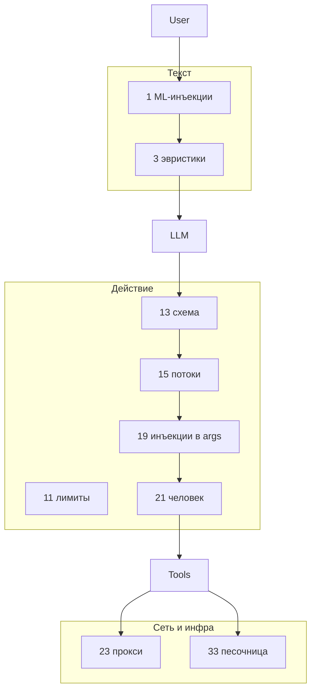

# Выводы по нечётным способам защиты

Синтез настольного исследования по 23 способам. Подробности — в папке `10-methods/`.

## Лидеры по эффективности и прочности

| Способ | Эффект. | Прочн. | Почему |
|--------|---------|--------|--------|
| [[23-egress-proxy-ssrf]] | высокая | высокая* | SSRF и утечка при **сетевой изоляции** агента; *без изоляции — низкая |
| [[13-json-schema-args]] | высокая | высокая | Строгая схема + удаление лишних полей |
| [[15-flow-rules]] | высокая | высокая | Детерминированные токсичные цепочки |
| [[17-smt-monotonic-privilege]] | высокая | высокая | Формальная монотонность; зрелость внедрения ниже |
| [[19-injection-rules-args]] | высокая | средняя | Проверенные паттерны WAF на аргументах |
| [[33-microvm-container]] | высокая | высокая | Ограничение ущерба от исполнения |
| [[43-dual-llm-quarantine]] | высокая | высокая | Лучший ответ на косвенную инъекцию; сложность |
| [[11-rate-cost-token-limits]] | высокая | высокая | Обязательный базовый слой |
| [[21-human-in-the-loop]] | высокая | высокая | Критичные действия |
| [[07-secrets-detection-text]] | высокая | средняя | Зрелый DLP-подход |

## Средний уровень (полезны с оговорками)

| Способ | Оговорка |
|--------|----------|
| [[01-ml-injection-classifier]] | Обход кодированием и многоязычностью; только первый рубеж |
| [[03-heuristics-regex-injection]] | Нужна нормализация; семантические обходы |
| [[05-pii-masking-detection]] | Не блокирует утечку через инструменты |
| [[25-rugpull-hash-baseline]] | Окно TOCTOU; злонамеренный первый baseline |
| [[27-skill-static-scan]] | Только статика; пропуски при обфускации |
| [[31-admission-blocklist]] | Ценность = цикл «скан → принудительный блок» |
| [[35-execution-rings-jail]] | Тюрьма каталога — ОК; кольца — меньше доказательств |

## Слабый уровень / не контроли безопасности

| Способ | Вердикт |
|--------|---------|
| [[09-factcheck-hallucination]] | Качество ответов, не атаки на агента |
| [[37-behavioral-anomaly]] | Дополнение; много ложных тревог |
| [[39-hash-chained-audit]] | **Только аудит** — обязателен, но не блокирует |
| [[41-compliance-mapping]] | **GRC** — сопоставление ≠ контроль |
| [[45-agentdojo-benchmark]] | **Мета** — измеритель, не защита |

## Завышенные ожидания

1. Один ML-классификатор инъекций — без правил потоков, схемы и прокси.
2. Compliance-отчёт — без [[15-flow-rules]] и [[23-egress-proxy-ssrf]] в продакшене.
3. Только статическое сканирование навыков — без [[31-admission-blocklist]].
4. Поведенческая аномалия как **единственная** защита.

## Недооценённые

1. [[11-rate-cost-token-limits]] — скучно, но высокая отдача.
2. [[13-json-schema-args]] + [[19-injection-rules-args]] — дешёвый детерминизм.
3. [[23-egress-proxy-ssrf]] + [[33-microvm-container]] — архитектурная связка.
4. [[17-smt-monotonic-privilege]] — лучшие цифры AgentDojo (`source-progent-paper`).

## Рекомендуемый минимальный стек

## Хаб доказательств

[[45-agentdojo-benchmark]]; источники: `source-agentdojo-paper`, `source-progent-paper` (без wikilink — см. `40-sources/`).

## Навигация

- [[MOC — Нечётные способы]]
- [[MOC — Матрица угроз]]
- [[00 Home]]
