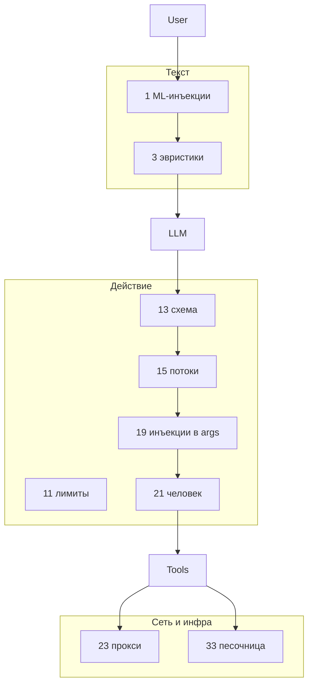

# Выводы по нечётным способам защиты

Синтез настольного исследования по 23 способам. Подробности — в папке `10-methods/`.

## Лидеры по эффективности и прочности

| Способ | Эффект. | Прочн. | Почему |
|--------|---------|--------|--------|
| [[23-единый-прокси-исходящих-запросов-и-защита-от-ssrf]] | высокая | высокая* | SSRF и утечка при **сетевой изоляции** агента; *без изоляции — низкая |
| [[13-проверка-аргументов-по-json-схеме]] | высокая | высокая | Строгая схема + удаление лишних полей |
| [[15-правила-последовательности-вызовов-и-потоков-данных]] | высокая | высокая | Детерминированные токсичные цепочки |
| [[17-формальная-проверка-политик-и-сужение-привилегий]] | высокая | высокая | Формальная монотонность; зрелость внедрения ниже |
| [[19-правила-против-инъекций-в-аргументах-инструментов]] | высокая | средняя | Проверенные паттерны WAF на аргументах |
| [[33-изоляция-агента-в-микровиртуальных-машинах-и-контейнерах]] | высокая | высокая | Ограничение ущерба от исполнения |
| [[43-две-модели-с-разделением-доверия-и-карантином]] | высокая | высокая | Лучший ответ на косвенную инъекцию; сложность |
| [[11-ограничение-токенов-расходов-и-частоты-вызовов]] | высокая | высокая | Обязательный базовый слой |
| [[21-одобрение-опасных-действий-человеком]] | высокая | высокая | Критичные действия |
| [[07-выявление-секретов-в-тексте]] | высокая | средняя | Зрелый DLP-подход |

## Средний уровень (полезны с оговорками)

| Способ | Оговорка |
|--------|----------|
| [[01-классификация-инъекций-машинным-обучением]] | Обход кодированием и многоязычностью; только первый рубеж |
| [[03-правила-и-шаблоны-для-выявления-инъекций]] | Нужна нормализация; семантические обходы |
| [[05-выявление-и-маскирование-персональных-данных]] | Не блокирует утечку через инструменты |
| [[25-контроль-целостности-описаний-инструментов]] | Окно TOCTOU; злонамеренный первый baseline |
| [[27-статическая-проверка-навыков-и-плагинов]] | Только статика; пропуски при обфускации |
| [[31-допуск-артефактов-и-отзыв-по-чёрному-списку]] | Ценность = цикл «скан → принудительный блок» |
| [[35-уровни-исполнения-и-изоляция-рабочего-каталога]] | Тюрьма каталога — ОК; кольца — меньше доказательств |

## Слабый уровень / не контроли безопасности

| Способ | Вердикт |
|--------|---------|
| [[09-проверка-фактической-точности-и-галлюцинаций]] | Качество ответов, не атаки на агента |
| [[37-выявление-поведенческих-отклонений]] | Дополнение; много ложных тревог |
| [[39-неизменяемый-журнал-с-цепочкой-хешей-и-подписями]] | **Только аудит** — обязателен, но не блокирует |
| [[41-сопоставление-защит-с-требованиями-стандартов]] | **GRC** — сопоставление ≠ контроль |
| [[45-agentdojo-как-эталонный-набор-испытаний]] | **Мета** — измеритель, не защита |

## Завышенные ожидания

1. Один ML-классификатор инъекций — без правил потоков, схемы и прокси.
2. Compliance-отчёт — без [[15-правила-последовательности-вызовов-и-потоков-данных]] и [[23-единый-прокси-исходящих-запросов-и-защита-от-ssrf]] в продакшене.
3. Только статическое сканирование навыков — без [[31-допуск-артефактов-и-отзыв-по-чёрному-списку]].
4. Поведенческая аномалия как **единственная** защита.

## Недооценённые

1. [[11-ограничение-токенов-расходов-и-частоты-вызовов]] — скучно, но высокая отдача.
2. [[13-проверка-аргументов-по-json-схеме]] + [[19-правила-против-инъекций-в-аргументах-инструментов]] — дешёвый детерминизм.
3. [[23-единый-прокси-исходящих-запросов-и-защита-от-ssrf]] + [[33-изоляция-агента-в-микровиртуальных-машинах-и-контейнерах]] — архитектурная связка.
4. [[17-формальная-проверка-политик-и-сужение-привилегий]] — лучшие цифры AgentDojo (`source-progent-paper`).

## Рекомендуемый минимальный стек

## Хаб доказательств

[[45-agentdojo-как-эталонный-набор-испытаний]]; источники: `source-agentdojo-paper`, `source-progent-paper` (без wikilink — см. `40-sources/`).

## Навигация

- [[MOC — Нечётные способы]]
- [[MOC — Матрица угроз]]
- [[00 Home]]
