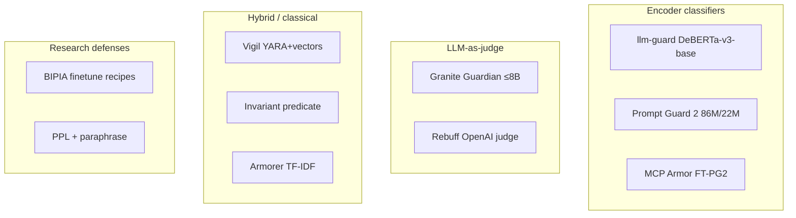

# Сравнение — способ №1: ML-классификаторы инъекций

Сводная таблица по репозиториям, которые попали в Dataview способа №1 (`method-id = 1` или `also-method-ids` содержит 1) **и реально реализуют** ML/нейросетевую (или классическую ML) детекцию prompt injection / jailbreak — не только red-team или эвристики.

Способ: [[01-классификация-инъекций-машинным-обучением]].
Семейство: [[cluster-content-guardrails-ml]].

> [!WARNING] Метрики несравнимы напрямую
> Acc/F1 Protect AI, AUC/Recall@1%FPR Meta и APR@utility Meta — **разные протоколы и наборы**. Цифры показывают, что авторы публикуют, а не рейтинг «кто лучше». Независимые бенчмарки часто ниже vendor-цифр.

## Скоуп: 37 → ядро сравнения

| Фильтр | Число |
|--------|------:|
| Карточки Dataview способа №1 | 37 |
| С собственной/вшитой ML-детекцией PI (ниже) | **10** |
| Исключены: red-team/бенчмарк, heuristics-only, шлюз без своей модели | 27 |

## Сводная таблица

| Репозиторий | Архитектура | Размер | Задачи | Метрики (источник) | Данные | Вердикт |
|-------------|-------------|--------|--------|-------------------|--------|---------|
| [[repo-40-llm-guard]] | DeBERTa-v3 classifier | ~86M backbone (~0.2B с embeddings) | prompt injection (EN); jailbreak **нет** | Eval: Acc 99.93% / F1 99.93%; post 20k: Acc 95.25% / P 91.59% / R 99.74% / F1 95.49% ([HF card](https://huggingface.co/protectai/deberta-v3-base-prompt-injection-v2)) | Сборка публичных датасетов (xstest, open-instruct, Salad-Data, jailbreak-classification, Mixed-Techniques-2024 и др.); объём train **н/д** | prod |
| [[repo-37-purplellama]] | mDeBERTa / DeBERTa-xsmall (Prompt Guard 2) | **86M** и **22M** | injection + jailbreak; EN + multilingual (86M) | Private OOD: AUC EN **0.998** / **0.995**; Recall@1%FPR EN **97.5%** / **88.7%**; APR@3% utility **81.2%** / **78.4%** (ProtectAI на том же протоколе Meta: **22.2%**) ([model card](https://github.com/meta-llama/PurpleLlama/blob/main/Llama-Prompt-Guard-2/86M/MODEL_CARD.md)) | «Large corpus» атак; точный N **н/д** (private eval) | prod |
| [[repo-113-mcp-armor]] | Fine-tune Prompt Guard 2 (HF pipeline) | как база PG2 (**н/д** точный checkpoint size) | PI в MCP metadata (tools/resources/prompts); порог ≥ 0.8 | В репо **не опубликованы** | **н/д** | experimental |
| [[repo-49-granite-guardian]] | LLM-as-judge (Granite Guardian) | до **8B** (4.1-8b и др.) | risk / jailbreak / injection criteria, toxicity, groundedness, tools | В vault/репо как единый Acc/F1 для PI — **н/д** | **н/д** | experimental |
| [[repo-41-rebuff]] | Heuristics + vector (Pinecone) + **LLM judge** (OpenAI) | внешняя LLM; индекс атак | prompt injection | **н/д** | известные атаки в vector DB; N **н/д** | experimental |
| [[repo-42-vigil-llm]] | YARA + embeddings (Chroma) + optional transformers | embeddings **н/д** | injection / jailbreak (+ secrets YARA) | **н/д** | corpus known jailbreaks; возраст данных — риск | experimental |
| [[repo-46-invariant]] | Flow rules + предикат `prompt_injection(text, threshold)` | классификатор **н/д** (локальный / cloud) | PI как вспомогательный сигнал к правилам потоков | **н/д** | **н/д** | experimental |
| [[repo-107-armorer-guard]] | Rules + **TF-IDF linear** (Rust, TSV weights) | лёгкая линейная; binary без GPU | injection / jailbreak / exfil patterns | Авторские метрики заявлены, независимо **не воспроизведены**; чисел в vault нет | встроенные weights; train provenance **н/д** | experimental |
| [[repo-88-bipia]] | Research defenses (few-shot / finetune / special tokens) на базе BIPIA | зависит от victim LM | **косвенные** PI (IPI) | ASR в paper arXiv 2312.14197; в vault чисел нет | benchmark splits: email / qa / code / table | experimental |
| [[repo-91-baseline-defenses]] | Perplexity filter + paraphrase (GPT) | зависит от LM для PPL | adversarial / jailbreak (шире PI) | paper arXiv 2309.00614; в vault чисел нет | **н/д** | experimental |

Детали механизмов: [[llm-guard-prompt-injection]], [[promptguard2-prompt-injection]], [[mcp-armor-local-prompt-classifier]], [[granite-guardian-yesno]], [[rebuff-triple-detection]], [[vigil-yara-vectordb]], [[invariant-prompt-injection]], [[impl-armorer-guard]], [[bipia-benchmark-defenses]], [[baseline-defenses-ppl-paraphrase]].

## Архитектура (классы)

| Класс | Репозитории | Типичный trade-off |
|-------|-------------|-------------------|
| Encoder (BERT-family) | llm-guard, PurpleLlama/PG2, MCP Armor | Низкая latency, локальный инференс; окно ~512 tok |
| LLM risk judge | Granite Guardian, Rebuff (cloud) | Шире критерии риска; дороже и медленнее |
| Classical / hybrid | Armorer, Vigil, Invariant | Дешёво / explainable; слабее на новых парафразах |
| Research | BIPIA, baseline-defenses | Рецепты и бенчмарки, не drop-in prod scanner |

## Размер модели

| Порядок | Примеры |
|---------|---------|
| ~20–90M encoder | Prompt Guard 2 **22M** / **86M**; llm-guard DeBERTa-v3-base (~86M backbone) |
| Линейная / embeddings | Armorer TF-IDF; Vigil Chroma |
| ~8B judge | Granite Guardian 4.1-8b |
| Внешняя API-LLM | Rebuff (OpenAI) |

## Решаемые задачи

| Задача | Кто явно целит |
|--------|----------------|
| Прямая prompt injection | llm-guard, PG2, Rebuff, Vigil, Armorer, Invariant, MCP Armor |
| Jailbreak | PG2, Vigil, Armorer, Granite (criteria), baseline-defenses |
| Косвенная / IPI | BIPIA (фокус); PG2 частично (CyberSecEval-семейство у Meta) |
| Toxicity / groundedness / tools | Granite Guardian (шире moderation) |
| Только EN injection | llm-guard v2 (явно: не jailbreak, не multilingual) |
| Multilingual attacks | PG2 86M (AUC multi **0.995**) |

## Метрики: что сравнивать осторожно

| Источник | Что меряет | Комментарий |
|----------|------------|-------------|
| Protect AI HF | Acc/P/R/F1 на своих eval / 20k holdout | Высокий recall на своём распределении; Meta APR@3% utility для «ProtectAI» = **22.2%** на *их* протоколе |
| Meta Prompt Guard 2 | AUC, Recall@1%FPR, APR@utility | Лучше отражает high-precision режим; eval private |
| Остальные | часто только latency или paper ASR | В OSS-карточках quality-цифр почти нет |

Практический вывод для выбора порога: ориентироваться на **свой** валидационный набор (чат / RAG / tool output), а не на vendor Acc.

## Объём данных

| Репозиторий | Что известно |
|-------------|--------------|
| llm-guard / Protect AI | Список исходных датасетов на HF; **N train не указан**; post-eval = 20 000 |
| Prompt Guard 2 | «Large corpus»; точный N и состав train **закрыты** |
| BIPIA | Публичные benchmark splits в репо |
| Rebuff / Vigil | Индекс/корпус известных атак; размер **н/д** |
| Armorer / Invariant / Granite / MCP Armor / baselines | В проверенных срезах vault **н/д** |

## Исключены из ядра сравнения (кратко)

Попали в Dataview способа №1, но **не** являются сравнимым ML-классификатором PI:

| Группа | Примеры | Почему вне таблицы |
|--------|---------|-------------------|
| Red-team / fuzz / eval | [[repo-76-garak]], [[repo-77-pyrit]], [[repo-78-promptfoo]], [[repo-80-fuzzyai]], [[repo-81-spikee]], [[repo-82-augustus]], [[repo-83-deepteam]], [[repo-84-moonshot]], [[repo-85-ps-fuzz]], [[repo-86-llmfuzzer]], [[repo-87-promptmap]], [[repo-75-agentfence]], [[repo-45-plexiglass]] | Способ №44: атакуют/измеряют, не фильтруют в prod |
| Benchmark suites | [[repo-67-injecagent]], [[repo-71-open-prompt-injection]], [[repo-72-jailbreakbench]] | Способ №45 |
| Heuristics / canary без своей PI-модели | [[repo-03-aegis]], [[repo-92-prompt-injection-shield]], [[repo-43-langkit]] | Regex/weighted rules / proactive canary |
| Фреймворк rails без своей модели | [[repo-38-guardrails]], [[repo-39-guardrails]] | Colang/validators; ML опционален снаружи |
| Шлюз / чужая модель | [[repo-47-invariant-gateway]], [[repo-19-bifrost]] | Нет собственного классификатора |
| Другой способ, ошибочно/побочно помечен | [[repo-48-heimdallm]] (SQL AST), [[repo-44-circuit-breakers]] (№22), [[repo-90-llm-self-defense]] (№2), [[repo-89-autodefense]] (скорее №43 multi-agent) | Не runtime PI-encoder |

Полный Dataview-список — в карточке способа №1.

## Как пользоваться этой заметкой

1. Выбор **prod encoder**: сравнить [[repo-40-llm-guard]] и [[repo-37-purplellama]] (размер, multilingual, jailbreak, метрики на *вашем* наборе).
2. MCP metadata: [[repo-113-mcp-armor]] как обёртка над PG2-семейством.
3. Нужен explainable / offline binary: [[repo-107-armorer-guard]].
4. Широкий risk rubric (не только PI): [[repo-49-granite-guardian]].
5. Не смешивать vendor Acc с Meta APR без оговорки о протоколе.

## Навигация

- [[01-классификация-инъекций-машинным-обучением]] — определение способа
- [[cluster-content-guardrails-ml]] — семейство репозиториев
- [[MOC — Способы]] — все 46 способов
- [[github-100-repo]] — полный каталог
