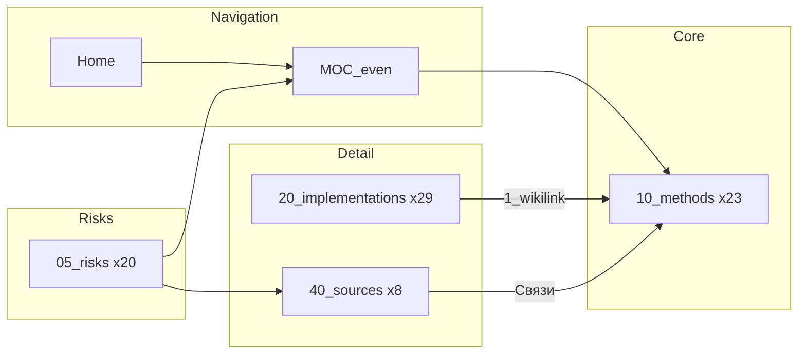

# Аудит связей vault (even-batch)

**Статус:** GREEN | fail=0 warn=0 info=1  
**Дата:** 2026-07-08  
**Маршрут:** obsidian-suite → obsidian-vault → obsidian-markdown → `audit_vault_links.py`

## Executive summary

| Метрика | До P1 | После P1 |
|---------|-------|----------|
| fail | 48 | **0** |
| warn | 3 | **0** |
| info | — | 1 (pipeline link) |

Структурные валидаторы (`validate_vault_note.py`, `lint_obsidian_md.py`) — **0 FAIL** на 60 core-заметках.

## Inventory

- Methods: 23
- Implementations: 29 (5 methods с несколькими impl: №6, №12, №26, №30, №44)
- Sources: 8
- Risks: 20
- MOC notes: 5
- Wikilink edges: 345

## Слои проверки

| Слой | Результат |
|------|-----------|
| 1 Wikilink-граф | OK — нет cross-method wikilink в `10-methods/`; impl: ровно 1 link в «Связи» |
| 2 YAML-семантика | OK — complements/requires/sources/covers валидны; `even-batch` на всех methods |
| 3 Двунаправленность | OK — source↔method согласованы после добавления OWASP в `sources:` |
| 4 MOC | OK — все 23 method в `MOC — Чётные способы` |
| 5 Risks | OK — 20 risk notes ссылаются на актуальные OWASP sources |
| 6 Pipeline | Не изменялся; 1 cross-folder link в `Home.md` → `research/composer/` |

## Граф (упрощённый)



## Исправления P1 (применены)

1. **`05-risks/` (20 файлов):** `source-owasp-llm-top10` → `source-owasp-llm-2025`, `source-owasp-asi-top10` → `source-owasp-agentic-2026`
2. **OWASP `sources:` в methods:** добавлены в №2, №6, №10, №12, №16, №26, №28, №46
3. **`Правила связей.md`:** «MOC — Нечётные способы» → «MOC — Чётные способы»; пример impl-link → `10-json-schema-constrained`

## Info (не блокирует)

- `30-mocs/Home.md` — wikilink `[[../research/composer/11-full-matrix|…]]` (граница pipeline, намеренно)

## Инструменты

```bash
# Полный аудит + отчёт
python .agents/skills/obsidian-shared/scripts/audit_vault_links.py --report research/composer/audit-links-even-batch.md

# Точечная валидация
python .agents/skills/obsidian-shared/scripts/validate_vault_note.py <file.md>
python .agents/skills/obsidian-shared/scripts/lint_obsidian_md.py <file.md>
```
