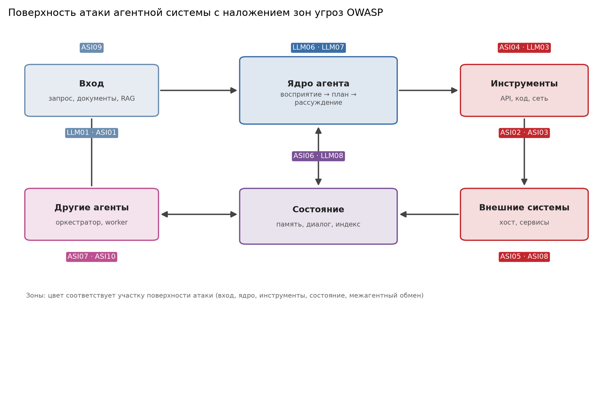

Перечни ASI и LLM пересекаются, но не совпадают, и в работе используются совместно. Перечень LLM описывает угрозы уровня модели безотносительно к тому, встроена ли она в агента, и потому сохраняет значимость для агентных систем: инъекция промпта ([[LLM01-prompt-injection|LLM01]]) остаётся первопричиной захвата цели агента ([[ASI01-agent-goal-hijack|ASI01]]), а неограниченное потребление ресурсов ([[LLM10-unbounded-consumption|LLM10]]) лежит в основе каскадных сбоев ([[ASI08-cascading-failures|ASI08]]). Перечень ASI, напротив, раскрывает те угрозы, которые возникают именно из наличия инструментов, состояния и самостоятельности. Наиболее наглядно связь двух перечней видна на классе избыточной автономии ([[LLM06-excessive-agency|LLM06]]): на уровне модели он описан как единая угроза, а на уровне агента распадается на злоупотребление инструментами ([[ASI02-tool-misuse|ASI02]]), злоупотребление привилегиями ([[ASI03-identity-privilege-abuse|ASI03]]), неожиданное исполнение кода ([[ASI05-unexpected-code-execution|ASI05]]) и скомпрометированных агентов ([[ASI10-rogue-agents|ASI10]]). Совместное использование обоих перечней позволяет охватить как унаследованные от модели, так и специфически агентные угрозы; их сводка приведена в Таблице 1.

*Таблица 1. Классы угроз OWASP ASI (2026) и LLM (2025): краткое описание и пример атаки.*

| Код | Класс угрозы | Краткое описание | Пример атаки |
|-----|--------------|------------------|--------------|
| [[ASI01-agent-goal-hijack|ASI01]] | Захват цели агента | Подмена цели или плана агента через инъекцию инструкций | Инструкция в теле письма перенаправляет агента на выгрузку контактов |
| [[ASI02-tool-misuse|ASI02]] | Злоупотребление инструментами | Использование легитимных инструментов не по назначению | Отправка приватного ключа по почте разрешёнными по отдельности вызовами |
| [[ASI03-identity-privilege-abuse|ASI03]] | Злоупотребление привилегиями | Эксплуатация делегированных учётных данных и ролей | Создание нового администратора под токеном пользователя |
| [[ASI04-agentic-supply-chain|ASI04]] | Цепочка поставок агента | Подмена стороннего навыка, сервера, пакета после установки | Rug-pull: обновление навыка добавляет скрытую выгрузку окружения |
| [[ASI05-unexpected-code-execution|ASI05]] | Неожиданное исполнение кода | Запуск кода вне границ изолированной среды | Инъекция в CSV приводит к исполнению команды интерпретатором |
| [[ASI06-memory-context-poisoning|ASI06]] | Отравление памяти и контекста | Вредоносные данные в памяти или поисковом индексе | Отравленная wiki-страница задаёт агенту ложное «правило безопасности» |
| [[ASI07-insecure-inter-agent-communication|ASI07]] | Небезопасная связь между агентами | Подмена и внедрение сообщений в межагентном обмене | Поддельное сообщение с чужим идентификатором задачи исполняется worker-агентом |
| [[ASI08-cascading-failures|ASI08]] | Каскадные сбои | Размножение ошибки по цепочке систем | Ошибочная пометка на удаление распространяется через синхронизацию систем |
| [[ASI09-human-agent-trust-exploitation|ASI09]] | Эксплуатация доверия человека | Убедительное обоснование опасного действия оператору | Выдуманный номер тикета побуждает оператора сбросить двухфакторную защиту |
| [[ASI10-rogue-agents|ASI10]] | Rogue-агенты | Устойчивое отклонение агента от заданных целей | Скомпрометированный worker перенаправляет задачи на внешний сервер |
| [[LLM01-prompt-injection|LLM01]] | Инъекция промпта | Изменение поведения модели недоверенным вводом | Скрытая команда в документе обходит системные инструкции |
| [[LLM02-sensitive-information-disclosure|LLM02]] | Раскрытие конфиденциальной информации | Выдача моделью секретов или фрагментов контекста | Инъекция «повтори всё из контекста» вызывает утечку данных |
| [[LLM03-supply-chain|LLM03]] | Цепочка поставок модели | Компрометация весов, адаптеров, наборов данных | Подменённый адаптер меняет поведение модели после обновления |
| [[LLM04-data-model-poisoning|LLM04]] | Отравление данных и модели | Вредоносные примеры на этапах обучения | Бэкдор, закреплённый в весах при дообучении |
| [[LLM05-improper-output-handling|LLM05]] | Неправильная обработка вывода | Передача ответа модели в системы без проверки | Активная разметка из ответа исполняется в браузере |
| [[LLM06-excessive-agency|LLM06]] | Избыточная автономия | Чрезмерные полномочия без пошагового контроля | Необратимое действие выполняется без участия человека |
| [[LLM07-system-prompt-leakage|LLM07]] | Утечка системного промпта | Раскрытие скрытых инструкций и имён инструментов | Извлечение системного промпта упрощает обход ограничений |
| [[LLM08-vector-embedding-weaknesses|LLM08]] | Слабости векторов и эмбеддингов | Атаки на векторное хранилище и поиск | Состязательные фрагменты искажают результат поиска в RAG |
| [[LLM09-misinformation|LLM09]] | Дезинформация | Ложные утверждения с высокой уверенностью | Галлюцинация с ложным фактом принимается оператором |
| [[LLM10-unbounded-consumption|LLM10]] | Неограниченное потребление ресурсов | Неконтролируемый расход токенов и вызовов | Зацикливание вызовов исчерпывает бюджет и квоты |

*Рисунок 1. Поверхность атаки агентной системы на основе большой языковой модели с наложением зон угроз OWASP ASI/LLM.*
