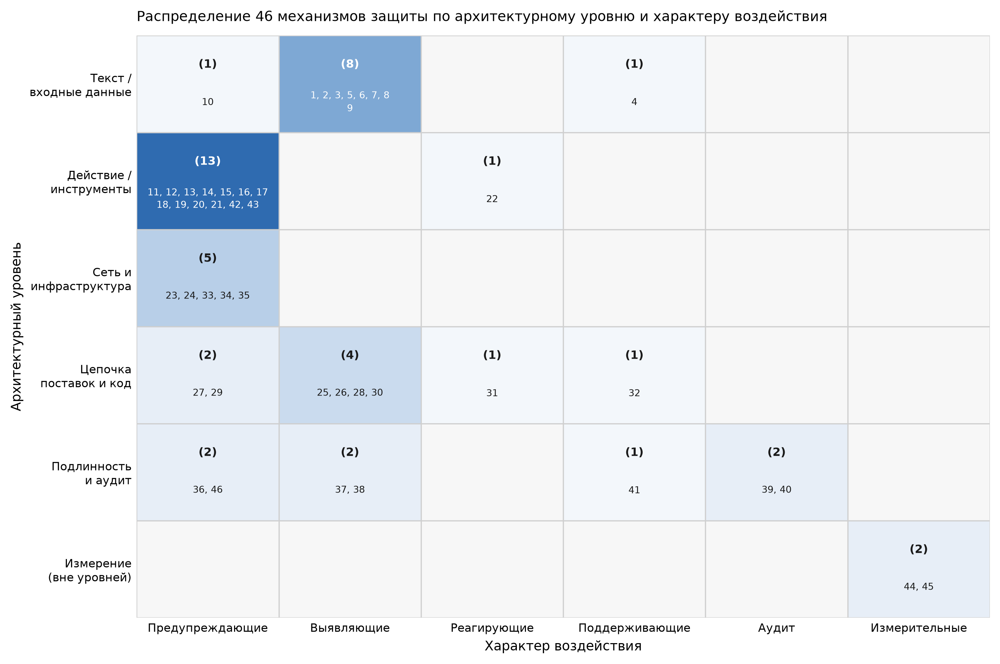

Механизмы защиты агентных систем систематизированы по двум независимым признакам. Первый признак — архитектурный уровень, на котором механизм включается в работу агента. Уровень определяется не типом реализующего продукта, а точкой в потоке управления и данных, где средство перехватывает воздействие: разбор входного текста, вызов инструмента, сетевое обращение, установка компонентов, ведение записи о действиях агента. Различаются пять уровней. [[4.2. Уровень «Текст или входные данные»|Уровень «Текст или входные данные»]] охватывает обработку запроса пользователя, ответа модели и содержимого, поступающего от внешних источников, до того как оно повлияет на решения агента. [[4.3. Уровень «Действие или инструменты»|Уровень «Действие или инструменты»]] отвечает за контроль вызова инструментов — состав аргументов, допустимость операции, последовательность вызовов, объём предоставленных полномочий. [[4.4. Уровень «Сеть и инфраструктура»|Уровень «Сеть и инфраструктура»]] ограничивает исходящие обращения и изолирует среду исполнения агента. [[4.5. Уровень «Цепочка поставок и код»|Уровень «Цепочка поставок и код»]] отвечает за проверку описаний инструментов, зависимостей и исходного кода до их подключения к агенту. [[4.6. Уровень «Подлинность и аудит»|Уровень «Подлинность и аудит»]] обеспечивает идентификацию агента, фиксацию его действий и разбор инцидентов.

Второй признак — характер воздействия, отражающий роль механизма в жизненном цикле инцидента. Предупреждающий механизм не допускает нежелательное действие до его совершения (проверка аргументов, политики на вызовы, изоляция среды). Выявляющий механизм обнаруживает признак атаки или нарушения, но сам по себе действие не блокирует ([[01-классификация-инъекций-машинным-обучением|классификаторы вредоносных инструкций]], выявление секретов, анализ потоков данных). Реагирующий механизм прерывает или ограничивает уже начавшийся инцидент ([[22-kill-switch-circuit-breaker|аварийное отключение]], [[31-допуск-артефактов-и-отзыв-по-чёрному-списку|отзыв артефактов]]). Поддерживающий механизм не образует самостоятельного барьера, но повышает результативность других средств ([[04-unicode-normalization|нормализация Unicode]], инвентаризация компонентов, сопоставление с требованиями стандартов). Механизм аудита обеспечивает разбор действий агента после события ([[39-неизменяемый-журнал-с-цепочкой-хешей-и-подписями|неизменяемый журнал]], [[40-opentelemetry-siem|телеметрия]]). Измерительный механизм оценивает результативность самих средств защиты и не действует во время исполнения агента (регрессионные испытания, эталонные наборы).

Первая ось задаёт структуру изложения: подразделы [[4.2. Уровень «Текст или входные данные»|4.2]]–[[4.6. Уровень «Подлинность и аудит»|4.6]] последовательно рассматривают механизмы по архитектурным уровням. Вторая ось проходит сквозным признаком через все уровни, отражена в сводном перечне (Таблица 2) и обобщается в [[4.7. Обобщение по характеру воздействия|подразделе 4.7]]. Средства, не действующие во время исполнения агента, вынесены в отдельную группу «Измерение» и рассмотрены в [[6. Пробелы в защите и типовые заблуждения|разделе 6]].

Всего систематизировано 46 механизмов. По архитектурным уровням они распределены неравномерно: «Текст / входные данные» — 10, «Действие / инструменты» — 14, «Сеть и инфраструктура» — 5, «Цепочка поставок и код» — 8, «Подлинность и аудит» — 7, «Измерение» — 2. Распределение по обеим осям приведено на Рис. 3.

*Рисунок 3. Распределение 46 механизмов защиты по архитектурному уровню и характеру воздействия.*
