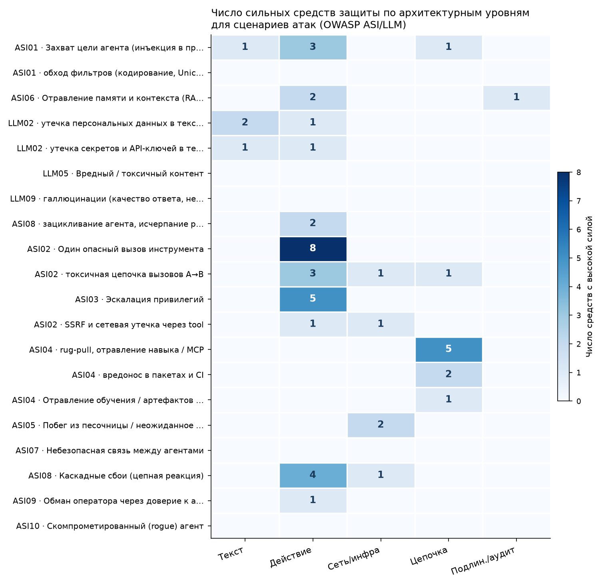

Перекрытие угроз рассматривается на карте, строками которой служат сценарии атак, отнесённые к классам OWASP ASI (2026) и LLM (2025), а столбцами — 46 механизмов защиты. Строки упорядочены по нумерации OWASP; отдельные классы представлены несколькими строками, уточняющими проявления угрозы внутри одного номера. В ячейке фиксируется сила средства против сценария по шкале «высокая / средняя / низкая / неприменимо» ([[3.4. Построение карты перекрытия и шкала оценки силы средства|подраздел 3.4]]). Такое построение позволяет читать карту в двух направлениях: по столбцу — какие угрозы перекрывает отдельный механизм, по строке — какими средствами и с какой силой перекрыта отдельная угроза.

Агрегированное представление карты, в котором сила средств сведена по архитектурным уровням, приведено на тепловой карте (Рис. 4). Она показывает, на каких уровнях сосредоточена защита каждой угрозы, и служит переходом от поэлементного описания к анализу глубины перекрытия.

*Рисунок 4. Тепловая карта перекрытия «угроза × архитектурный уровень»; интенсивность цвета соответствует силе средства.*

## Мета

- порядок чтения
- сценарии атак
