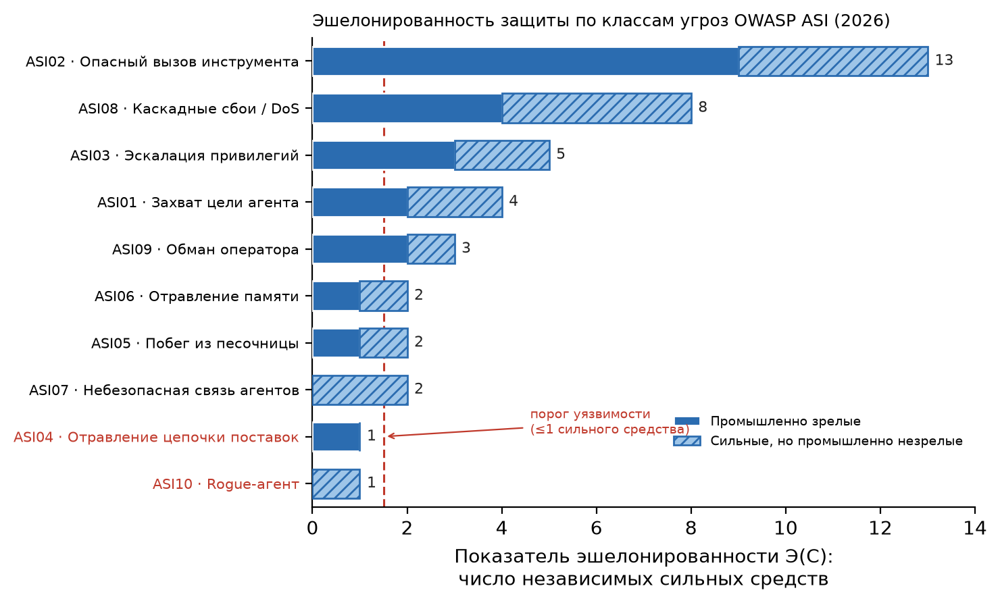

Для количественной оценки глубины перекрытия по каждому классу угроз ASI подсчитано число независимых средств, перекрывающих его с высокой силой ([[3.5. Показатель эшелонированности защиты|подраздел 3.5]]). Распределение показателя приведено на Рис. 5.

Распределение резко неравномерно. Наибольшую глубину защиты имеют злоупотребление инструментами ([[ASI02-tool-misuse|ASI02]]) — 13 сильных средств — и каскадные сбои ([[ASI08-cascading-failures|ASI08]]) — 8 средств. Далее следуют злоупотребление идентичностью и привилегиями ([[ASI03-identity-privilege-abuse|ASI03]]) — 5 средств, захват цели агента ([[ASI01-agent-goal-hijack|ASI01]]) — 4 средства, эксплуатация доверия человека ([[ASI09-human-agent-trust-exploitation|ASI09]]) — 3 средства. На нижней границе расположены неожиданное исполнение кода ([[ASI05-unexpected-code-execution|ASI05]]), отравление памяти и контекста ([[ASI06-memory-context-poisoning|ASI06]]) и небезопасная связь между агентами ([[ASI07-insecure-inter-agent-communication|ASI07]]) — по 2 средства, а также уязвимости цепочки поставок ([[ASI04-agentic-supply-chain|ASI04]]) и rogue-агенты ([[ASI10-rogue-agents|ASI10]]) — по одному сильному средству. Классы с одним сильным средством или без него представляют собой точки уязвимости: обход единственного средства оставляет угрозу неперекрытой.

Неравномерность объясняется тем же смещением совокупности средств, что установлено в [[4. Классификация механизмов защиты|разделе 4]]. Наиболее глубоко перекрыты угрозы, попадающие на несущий [[4.3. Уровень «Действие или инструменты»|уровень «Действие»]] и [[4.4. Уровень «Сеть и инфраструктура»|инфраструктурный уровень]], где сосредоточены предупреждающие средства широкого действия; слабее всего — угрозы, требующие защиты памяти, межагентного взаимодействия и подлинности компонентов, где зрелых средств мало.

*Рисунок 5. Эшелонированность защиты по десяти классам угроз OWASP ASI (2026): число независимых сильных средств на угрозу.*
