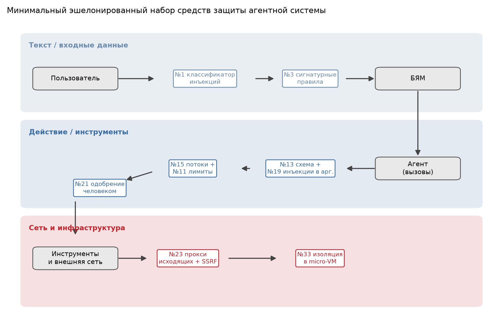

Минимальный эшелонированный набор образован средствами, отобранными по двум признакам: высокая результативность при перекрытии широкого набора угроз ([[4. Классификация механизмов защиты|раздел 4]]) и умеренная стоимость внедрения. Его состав приведён на Рис. 6.

На уровне текста набор включает обучаемый классификатор вредоносных инструкций ([[01-классификация-инъекций-машинным-обучением|№1]]) и сигнатурные правила ([[03-правила-и-шаблоны-для-выявления-инъекций|№3]]). Оба средства образуют первый рубеж обнаружения: они не пресекают атаку, но выделяют подозрительный вход для последующей проверки. Их включение оправдано низкой стоимостью и промышленной готовностью, а ограниченная устойчивость к обходу компенсируется барьерами следующего уровня.

На уровне действия набор включает пять средств. Ограничение расхода токенов, средств и частоты вызовов ([[11-ограничение-токенов-расходов-и-частоты-вызовов|№11]]) сдерживает неконтролируемое потребление ресурсов и каскадное разрастание действий. Проверка аргументов по схеме ([[13-проверка-аргументов-по-json-схеме|№13]]) совместно с правилами против инъекций в аргументах ([[19-правила-против-инъекций-в-аргументах-инструментов|№19]]) обеспечивает детерминированный контроль состава и содержания вызова. Правила последовательности вызовов и потоков данных ([[15-правила-последовательности-вызовов-и-потоков-данных|№15]]) перекрывают недопустимые цепочки действий. Подтверждение опасных действий человеком ([[21-одобрение-опасных-действий-человеком|№21]]) замыкает уровень на необратимых операциях. Именно этот уровень принимает решение о блокировке и несёт основную нагрузку защиты.

На уровне сети и инфраструктуры набор включает единый прокси исходящих запросов с защитой от подделки запросов со стороны сервера ([[23-единый-прокси-исходящих-запросов-и-защита-от-ssrf|№23]]) и изоляцию агента в микровиртуальных машинах и контейнерах ([[33-изоляция-агента-в-микровиртуальных-машинах-и-контейнерах|№33]]). Первое средство ограничивает сетевые обращения агента, второе — ограничивает последствия компрометации границами изолированной среды. Их сочетание образует инфраструктурный рубеж, устойчивый к обходу через саму языковую модель.

Обоснованность набора подтверждается картой перекрытия. Семь из десяти классов угроз ASI имеют в наборе хотя бы одно сильное средство, а наиболее вероятные угрозы уровня действия — злоупотребление инструментами ([[ASI02-tool-misuse|ASI02]]), каскадные сбои ([[ASI08-cascading-failures|ASI08]]) и злоупотребление привилегиями ([[ASI03-identity-privilege-abuse|ASI03]]) — перекрыты несколькими независимыми средствами набора. Пробелы набора совпадают со структурными пробелами всей совокупности средств (цепочка поставок, межагентное взаимодействие, rogue-агенты; [[6. Пробелы в защите и типовые заблуждения|раздел 6]]) и не могут быть устранены на текущем уровне зрелости средств.

*Рисунок 6. Минимальный эшелонированный набор средств защиты: поток «пользователь — большая языковая модель — инструменты — сеть» со встроенными средствами по уровням текста, действия и инфраструктуры.*
